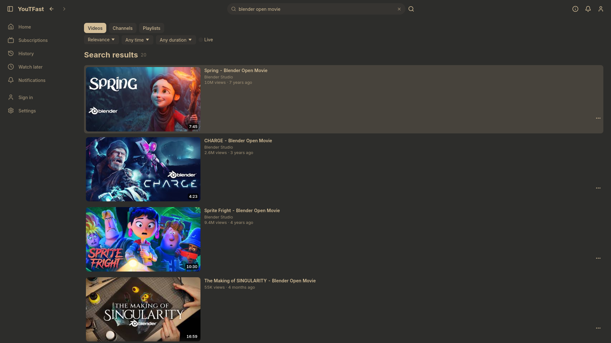

<p align="center">
  
</p>
<h1 align="center">YouTFast</h1>
<p align="center"><strong>YouTube, native and fast.</strong></p>
<p align="center">
  <a href="https://github.com/bcosta19/youtfast/releases">Releases</a> ·
  <a href="docs/user-guide.md">User guide</a> ·
  <a href="CHANGELOG.md">Changelog</a> ·
  <a href="CONTRIBUTING.md">Contribute</a>
</p>

A small native YouTube desktop client built with **Rust, egui and libmpv**.
Search, watch and keep your library in a desktop interface, with hardware video
decoding where supported. No browser engine, telemetry or YouTFast-operated
backend. Start signed out; accounts are optional.



*YouTFast 0.1.0 on Linux, signed out, searching for Blender's open movies.*

> [!NOTE]
> **YouTFast is young and still needs work.** It has a single maintainer and
> 0.1.0 is its first release: it already plays, searches and keeps a library,
> but expect rough edges and missing pieces. If something
> breaks or feels less polished than YouTube in the browser, that is a great
> place to help. See [how to contribute](#help-wanted).

## What you can do

| Feature | In YouTFast |
|---|---|
| Watch | In-window video, full screen, theater mode, audio-only mode and a compact mini player |
| Discover | Search filters, channel tabs, playlists, Shorts and paginated feeds |
| Stay in control | Captions, chapters, queue editing, configurable video buffer, keyboard shortcuts and desktop media controls |
| Keep a library | Device subscriptions, Watch later, history/resume, History sync and Google Takeout import |
| Read and explore | Descriptions, comments and attachments; optional transcripts and timeline previews |
| Make it yours | Six interface languages (EN, PT-BR, ES, FR, DE, IT), light/dark themes, palettes and native Linux Omarchy integration |

Optional accounts use the system credential store. Account ratings and playlist
edits affect the selected account; device subscriptions and device Watch later
stay local. [Read about accounts and stored data](docs/user-guide.md#your-library-with-or-without-an-account).

## Lighter than a website in a window

Many "YouTube desktop apps" are the website inside Electron. Measured on one
Linux laptop with the same search results, full screen, signed out
([method, all runs and caveats](docs/benchmarks.md)):

| | YouTFast 0.1.0 | Electron + youtube.com |
|---|---:|---:|
| Memory (PSS, all processes) | **161 MiB** | 658 MiB |
| CPU while idle on the page | **0%** | 18% of a core |
| Processes | **1** | 8 |
| On disk | **31 MB** (13 MB download) | 296 MB runtime alone |

Electron does show its first, still empty, window sooner. Playback has not
been compared yet; numbers from other machines are welcome.

## Installation

**0.1.0 is published as a pre-release; 0.2.0 is the current release candidate.**
Packages are built and tested headlessly on GitHub-hosted runners; interactive
checks on clean Windows and macOS machines are still in progress. Download from
[GitHub Releases](https://github.com/bcosta19/youtfast/releases).

| Platform | Package | Requirements |
|---|---|---|
| Linux x86_64 | Flatpak bundle | Flatpak, Freedesktop 25.08 runtime and desktop drivers/portals |
| Linux x86_64 | Native archive | glibc 2.39+, system libmpv and current yt-dlp/Deno; supports in-app updates |
| Windows x86_64 | ZIP with libmpv and DLLs | Current yt-dlp/Deno on PATH; supports in-app updates; no MSI/MSIX or publisher signature |
| macOS 15+ Apple Silicon | ZIP with app and dylibs | Current yt-dlp/Deno; supports in-app updates; ad-hoc signed, not notarized |
| Arch Linux x86_64 | Pacman package and source PKGBUILD | Built and installed in a clean Arch container by CI; AUR submission pending |

Native archives/bundles include an in-app updater in **Settings → About**
(SHA-256 verified against `checksums.txt`, with optional automatic minor/patch
updates and 1-click manual major updates). Release builds also generate
rendered Flathub, Winget and Homebrew Cask manifests (`channels.tar.gz`).
The Flatpak bundles its playback/extraction tools and targets compatible Linux
distributions at x86_64. It is not yet a Flathub listing or an app update remote.
The Arch recipe is not yet an AUR entry or an official pacman package.

[Installation, checksums and platform limits](docs/distribution.md) ·
[Arch package maintenance](packaging/arch/README.md)

## Build from source

Install the compiler and system dependencies in
[CONTRIBUTING.md](CONTRIBUTING.md#getting-started), then run from the checkout:

```sh
cargo run --locked --release
cargo run --locked --release -- "https://youtu.be/dQw4w9WgXcQ"
cargo run --locked --release -- "rust egui"
```

Playback needs libmpv with Lua support, current yt-dlp and its matching EJS/JS
runtime. Optional browser-session import also needs `python3` with the `yt_dlp`
module. See the [requirements](docs/user-guide.md#requirements).

## Help wanted

YouTFast gets better with every bug report, test run and pull request, and you
do not need to know Rust to help:

- **Try it and tell us what breaks.** Especially on Windows and macOS, which
  have only been tested by CI so far. Steps to reproduce help the most.
- **Pick an issue.** Look for
  [good first issues](https://github.com/bcosta19/youtfast/labels/good%20first%20issue)
  and [help wanted](https://github.com/bcosta19/youtfast/labels/help%20wanted).
- **Translate.** English, Brazilian Portuguese, Spanish, French, German, and Italian exist; more languages are welcome.
- **Package it.** Flathub and AUR submissions are open tasks.
- **Measure it.** Run the [benchmarks](docs/benchmarks.md) on your machine.

Start with [CONTRIBUTING.md](CONTRIBUTING.md); questions in issues are welcome.

## Guides and project status

| You want to… | Read |
|---|---|
| Learn controls, library, accounts and themes | [User guide](docs/user-guide.md) |
| Choose a package or check platform coverage | [Distribution](docs/distribution.md) |
| See release contents and exclusions | [Changelog](CHANGELOG.md) |
| See work that is not implemented yet | [Roadmap](ROADMAP.md) |
| Report a bug or contribute | [Contributing](CONTRIBUTING.md) |
| Report a security issue privately | [Security policy](SECURITY.md) |
| Compare resource use | [Benchmarks](docs/benchmarks.md) |
| Prepare a release | [Release process](RELEASING.md) |

Library/settings stay on this device. Account cookies belong in the native
credential store, and local diagnostics redact private details. Account access
is unofficial and can trigger Google verification, sign-out or suspension.
Use the app signed out unless you deliberately choose that integration.
[Storage, privacy and account details](docs/user-guide.md#your-library-with-or-without-an-account).

## Related projects and acknowledgements

- [Spotifast](https://github.com/crmne/spotifast) — native Spotify client.
- [ZapFast](https://github.com/crmne/zapfast) — native WhatsApp client.
- [fastframe](https://github.com/crmne/fastframe) — shared foundations for native
  egui desktop applications.

YouTFast follows native desktop conventions from these projects and uses shared
egui/winit forks. Thanks also to [mpv](https://mpv.io),
[yt-dlp](https://github.com/yt-dlp/yt-dlp),
[RustyPipe](https://codeberg.org/ThetaDev/rustypipe),
[egui](https://github.com/emilk/egui) and [Lucide](https://lucide.dev).

## License and disclaimer

[GPL-3.0-only](LICENSE). Dependencies retain their own licenses and notices;
see [THIRD_PARTY_NOTICES.md](THIRD_PARTY_NOTICES.md).

YouTFast is an unofficial client, unaffiliated with YouTube or Google. Using an
unofficial client may conflict with YouTube's terms of service. Use it at your
own risk.
