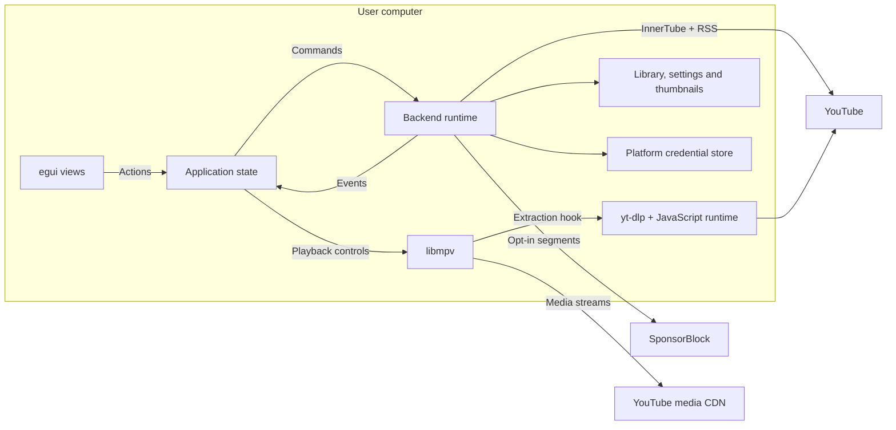
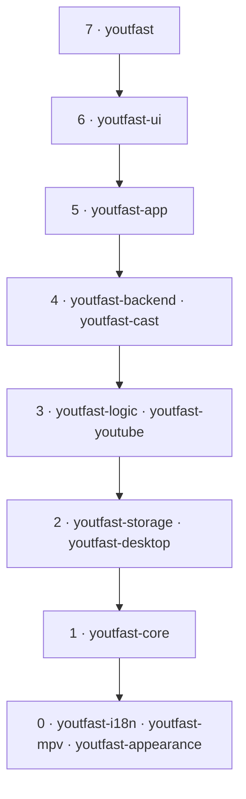
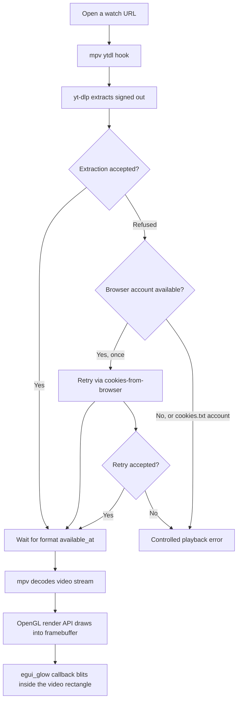
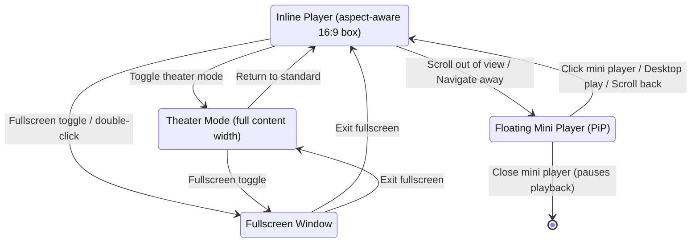
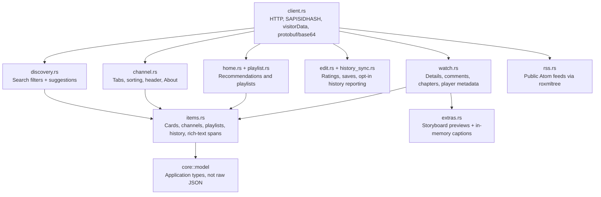
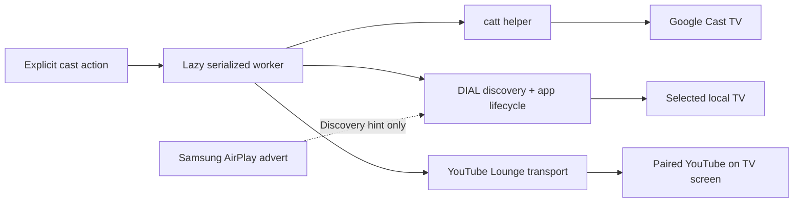
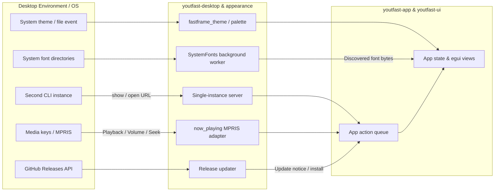

# YouTFast architecture

A native Rust + egui YouTube client. No browser engine, telemetry, hosted
backend or YouTFast-operated account system.

[AGENTS.md](../AGENTS.md) defines engineering constraints;
[CONTRIBUTING.md](../CONTRIBUTING.md#checks) defines checks;
[youtube-api-format.md](youtube-api-format.md) records InnerTube format changes.

## System boundaries

Arrows below show runtime communication, not Cargo dependencies.



Desktop services additionally contact GitHub Releases for updates; casting
contacts the selected TV and YouTube's Lounge service. The application is not
Rust-only at runtime: playback needs libmpv 0.42+ with Lua and current yt-dlp.
See [runtime requirements](../README.md) and [distribution](distribution.md).

## Crate layers

Arrows express the **allowed downward dependency direction**, not every edge
in Cargo. A crate must not depend on its own or a higher layer.



The root `Cargo.toml` owns package fields, dependency versions/features,
profiles and patches; crates inherit them with `.workspace = true`.
A module needing a higher layer belongs in that higher layer.

### Source map

All paths below are relative to [`crates/`](../crates/).

| Crate | Entry points and responsibility |
|---|---|
| `youtfast` | `src/main.rs`: CLI/startup; `src/demo.rs`: offline harness behind `demo`; `build.rs`: Windows icon embedding |
| `youtfast-ui` | `frame`: views; `player`, `watch`, `widgets`, `settings`, `account`: presentation; `bench`: frame-cost harness |
| `youtfast-app` | `App`, `State`, `Action`; `loading`, `watch`, `accounts`, `notifications`, `player`, `images`, `now_playing` |
| `youtfast-backend` | `src/lib.rs`: runtime, request scheduling and persistence writers; `protocol`: `Command`, `Event`, `Slot` |
| `youtfast-cast` | `src/lib.rs`: Google Cast adapter; `dial`: discovery/app lifecycle; `lounge`: YouTube on TV transport |
| `youtfast-youtube` | `innertube`: data/account API; `ytdlp`: extraction JSON; `extras`: captions/storyboards; `thumbs`: bounded image cache; `sponsorblock`: segments |
| `youtfast-logic` | `alerts`, `history`, `recommend`, `video_tabs`: pure decisions over application data |
| `youtfast-storage` | `library`, `settings`, `account`, `takeout`, `paths`: persistence, credentials and imports |
| `youtfast-desktop` | `instance`: single instance; `diagnostics`: redacted logs; `updater`: verified release installation |
| `youtfast-core` | `model`, `util`, `links`, `privacy`: shared types, formatting, URL parsing and controlled errors; no IO or drawing |
| `youtfast-i18n` | Build script compiles catalogs from `assets/i18n` |
| `youtfast-mpv` | `ffi`: client API 2.x; `Mpv`: player ownership/status; `render`: OpenGL video surface |
| `youtfast-appearance` | `theme`, `icons`, `desktop_font`: palette, transitions, installed fonts and desktop integration |

## Startup and one frame

```mermaid
sequenceDiagram
    participant Main as main
    participant App as App / interface thread
    participant Views as ui::frame
    participant Backend as Backend / Tokio thread
    participant Mpv as Mpv
    Main->>Main: Parse CLI, single-instance handoff, logs
    Main->>Main: Start SystemFonts worker
    Main->>App: App::new with youtfast_ui::frame callback
    loop Each frame
        App->>App: App::logic / poll events and desktop input
        App->>Mpv: Poll status
        App->>App: Playback, prefetch and suggestion ticks
        App->>Views: App::ui calls the injected Views callback
        Views-->>App: Actions; only view-local state mutates directly
        App->>App: App::apply after drawing
        App->>Mpv: Immediate playback controls
        App->>Backend: Commands for slow work
        Backend-->>App: Events carrying session epoch; request repaint
        App->>App: Reject stale generations and private session events
    end
```

The callback avoids a Cargo dependency from `app` to `ui`. Views never call the
backend. Requests use one current generation per `Slot`; `model::Source`
distinguishes account and device listings.

| Boundary | Contract |
|---|---|
| Interface thread | No network, imports, credential-store calls or notifications; slow/blocking work runs on the backend or its blocking workers |
| Exit | `App::on_exit` performs the final save, through the same `SaveGate` as background writers |
| FFI | Production `unsafe` is confined to `youtfast-mpv`; the UI benchmark's test-only allocator is the exception |
| Logging | External errors become fixed `privacy` messages; every log record passes `diagnostics::redact_log`, including verbose mode |
| Log targets | Every crate starts with `youtfast`, matching application log filters/redaction |

## Playback and the video surface



A failed retry also ends in the playback error. `account::ytdl_browser` supplies
the browser/profile and Linux keyring selection; account cookies are not
attached to normal extraction. Updating yt-dlp can fix extraction without an
application release. `ytdlp::ytdl_loaded` reads the hook's extraction JSON.

```mermaid
stateDiagram-v2
    [*] --> Waiting
    Visible --> Waiting: VideoSurface::forget on open, retry or stop
    Waiting --> Waiting: Drop old framebuffer on next draw; show black backing
    Waiting --> Visible: New file loaded AND fresh non-redraw frame
    Visible --> Visible: Redraw retains the last picture
    Waiting --> Waiting: Failed load never reveals the previous video
```

| Player/render invariant | Implementation |
|---|---|
| Quality | `mpv::FORMAT` follows the selected quality; Auto is bounded to 1080p |
| Buffer budget | Standard: 150 MiB ahead / 50 MiB behind; Compact: 50 / 20 MiB, selected by `Settings::playback_buffer` |
| GL lifetime | Create lazily with the GL context current; free in `App::on_exit` before mpv; dropping a surface never frees GL objects without a context |
| Scrolling | Keep the framebuffer at the full video's physical size; restore egui's scissor before blitting |
| Aspect | Size from `Status::video_aspect` (`video-out-params/aspect`, after autorotate) |
| Native integration | Pass Wayland/X11 display handles to mpv for hardware-decoding interop; the eframe fork exposes `CreationContext::get_proc_address` |
| End of video | `keep-open` makes `eof-reached`, not an end-file event, the playback completion signal |
| Next video | Queue first, then Up next, then related; Shorts loop with `loop-file` |

Keep the egui/winit fork revisions coordinated. The mini player must continue
drawing when the watch page is absent: an undrawn render-API output stalls.
Closing it pauses playback; desktop Play returns via `App::show_playing`.
`Settings::scroll_miniplayer` also allows handoff when the inline player scrolls
completely out of view; returning sets `State::watch_scroll_to_video`.



## YouTube data and parsing

Paths in this diagram are inside `youtfast-youtube::innertube`.



Arrows here show data/processing paths. The client pins its web version and
user agent in source: no version discovery, disk cache or response reports.
`visitorData` is fetched once per client; a refused client version requires a
source update. Requests use English/US (`hl`, `gl`); history maps only exact
Today/Yesterday headings to UTC dates, preserving other headings and account
order when merging device resume metadata.

| Parser/transport contract | Detail |
|---|---|
| Changing response layouts | `items::UnrecognisedItems` reports unknown list renderers; an empty parsed page warns instead of hiding a layout change |
| Channel pagination | `More::owner` fills missing channel identity/avatar, preserving collaborators' own identity |
| Comments | `commentSurfaceKey` resolves attachments and voice transcripts; written content wins over a transcript; thread priority marks pinned comments |
| Continuations | Both endpoint and button forms can load comment replies/pages; authenticated continuations keep their session context |
| Links in rich text | `Span` maps same-video timestamps, including `0:00`, to seeks; other video/channel/web links retain their target |
| TLS | InnerTube uses `reqwest` + the OS verifier (`rustls-platform-verifier`); thumbnails, SponsorBlock and updater use `ureq` with Mozilla roots |
| History sync | Explicitly opt-in; one report per playback after two seconds of active play, bound to the session at playback start; HTTPS YouTube tracking hosts only, no redirects |
| SponsorBlock | Off by default; requests use the first four hex digits of the video ID's SHA-256, never the full ID |

A history-report failure is `NotReported`, with no URLs, cookies or response
body exposed. Playback extraction remains independent of history reporting.
Response-format fixtures belong in [`tests/youtube_api.rs`](../crates/youtfast-youtube/tests/youtube_api.rs)
and module tests; format-change records and live-check instructions live in
[youtube-api-format.md](youtube-api-format.md).

## Persistence and account isolation

```mermaid
sequenceDiagram
    participant App as App
    participant Backend as Backend::send
    participant Watch as Snapshot watch channels
    participant Writer as Background writers
    participant Gate as SaveGate per file
    participant Disk as Atomic JSON files
    App->>Backend: Library/settings snapshot
    Backend->>Watch: Publish latest snapshot directly
    Watch->>Writer: Changed snapshot
    Writer->>Gate: Serialize write
    Gate->>Disk: write_atomic
    App->>Gate: Exit save_final
    Gate->>Gate: Wait for earlier writes; seal against later snapshots
    Gate->>Disk: Final library/settings snapshot
```

| Stored data | Location and guarantees |
|---|---|
| Library | `paths::Dirs::library`: device subscriptions, history/resume positions, Watch later |
| Settings | `paths::Dirs::settings`: playback, appearance and other preferences; new persisted fields need `#[serde(default)]` |
| Invalid input | Preserve invalid JSON/UTF-8 before defaults become writable; read failures or failed backups stop startup |
| Atomic writes | Reject non-regular targets; synchronize the parent directory on Unix |
| Takeout | Parse/merge off the UI thread; subscriptions CSV uses column positions because headings are localized; history comes from `watch-history.json` |
| Import bounds | 64 MiB; 20,000 unique subscriptions; latest 1,000 unique history entries; merge only if `App::library_revision` still matches |
| Image cache | One download shared by display/persistence; 4 MiB response, 4096 px per side, four million pixels; disk: 2,000 files / 128 MiB |
| Image lifetime | `images::remote` forgets undrawn images after one minute; downloads are bounded by `thumbs::DOWNLOADS`, retry with backoff, and cannot recreate forgotten retry entries |
| Kept thumbnails | `thumbs::cached` answers without waiting for a download turn |
| Watch details | `App::details_cache`: latest 50 videos, 30-minute lifetime |

```mermaid
sequenceDiagram
    participant UI as Account actions
    participant Backend as Backend session
    participant Store as Platform credential store
    participant Client as Fresh InnerTube Client
    participant YouTube as YouTube account API
    UI->>Backend: Select or sign in to an account
    Backend->>Backend: Order account writes; cancel stale loads; advance epoch
    Backend->>Store: Restore selected account's session
    Store-->>Backend: Cookies in memory only
    Backend->>Client: Validate session cookie
    Client->>YouTube: Authenticated request
    YouTube-->>Client: Accepted or rejected
    Client-->>Backend: Controlled result
    Backend-->>UI: Event carrying session epoch
    UI->>UI: Reject old private events; dismiss account menus
```

Browser sign-in uses yt-dlp's Python cookie extractor through a pipe, never a
file; cookies.txt import parses the user's chosen file. Browser sources can
include `browser:profile`; expired browser sessions can be read again on restore.
Credential-store calls use `spawn_blocking` with a timeout. Each account has
`youtube-session-<id>`; the legacy unnumbered entry migrates to account 1.

Cookies stay **only in the credential store and client memory**. They never
enter library/settings files, caches, logs or error messages. Authentication
failure invalidates private events from the **entire pending batch**, including
ones preceding the failure; device imports and thumbnails remain independent.

## Casting



The worker is outside the interface and InnerTube session runtime. Discovery
alone never starts playback, and an AirPlay advert never authorizes AirPlay
transport. Lounge pairing IDs/tokens live only in its worker; account cookies,
raw helper output, TV addresses and transport errors are not persisted.

## Desktop and view conventions



| Area | Architectural boundary |
|---|---|
| Single instance | `desktop::instance` accepts `show`, `open <text>`, `reload-themes`; the handler queues, `App` drains; a second process exits |
| Theme | `Settings::palette` resolves cached palettes; `fastframe_theme::Transition` reveals changes; filesystem notifications and `contrib/omarchy/youtfast-theme` trigger reload |
| Fonts | `SystemFonts` discovers fonts off-thread; `App` installs them when ready. Linux uses `fc-match` per weight and `fc-list :lang=en`; missing families fall back to Inter and set `face_missing` |
| Font memory | Loaded face bytes are shared for the process lifetime; tests/demo may use synchronous `theme::install_fonts` |
| Media controls | `now_playing` maps desktop commands to `Action`; Linux uses MPRIS; `SeekBy` is milliseconds and `SetVolume` is 0..1 |
| Notifications | Popup and full page share a visit snapshot and mark-seen action; new arrivals join the open snapshot; `logic::alerts` compares seen/notified stamps, backend schedules checks and off-thread notifications |
| Local recommendations | `logic::recommend` ranks related videos from recent history when account recommendations are unavailable |
| Rich text | `widgets` uses glyph logical rectangles for links; `Action::OpenUrl` enforces scheme restrictions; eframe's `links` feature is required |
| Idle rendering | `hover_fade` / `press_fade` request frames only during animation, using the style's `animation_time` |
| Shared page layout | Settings and Account use the same centered column/cards; index position and scroll selection remain view state in egui memory |
| Updater | GitHub Releases → SemVer classification → SHA-256 check against `checksums.txt` → atomic install; opt-in minor/patch updates may be automatic, major updates never are |
| Offline demo | `demo` has no backend, keyring, user files, network, media controls or single-instance channel |
| Desktop icons | `tools/icons.py` generates Windows/macOS icons from SVG; Windows `build.rs` invokes windres directly, including MSVC-host/GNU-target runners |

Watch layout belongs to `ui::watch` / `ui::player`: aspect-aware inline video,
theater mode, live controls, chapters, segment overlays and Up next. See
[DESIGN.md](../DESIGN.md) for layout rules and the [user guide](user-guide.md)
for controls and modes.

## Building and testing

Use [the contributor checks](../CONTRIBUTING.md#checks) for the workspace.
For one crate: `cargo test -p <crate>` builds only that crate and its dependencies.

- Response formats: `cargo test -p youtfast-youtube --test youtube_api`.
- Live public API: `cargo test -p youtfast-youtube --test youtube_api -- --ignored`.
  Signed-in flows need explicit interactive verification, not a saved session fixture.
- Frame cost: `cargo test --release -p youtfast-ui --lib frame_cost -- --ignored --nocapture --test-threads=1`.
