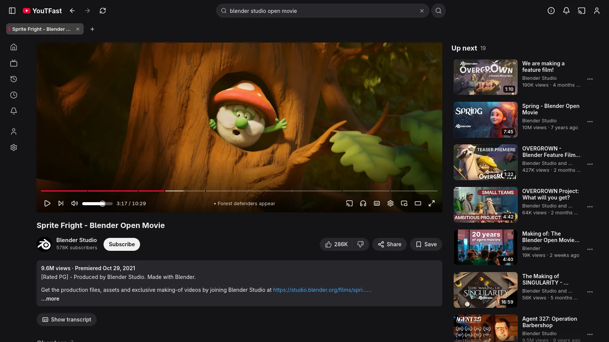
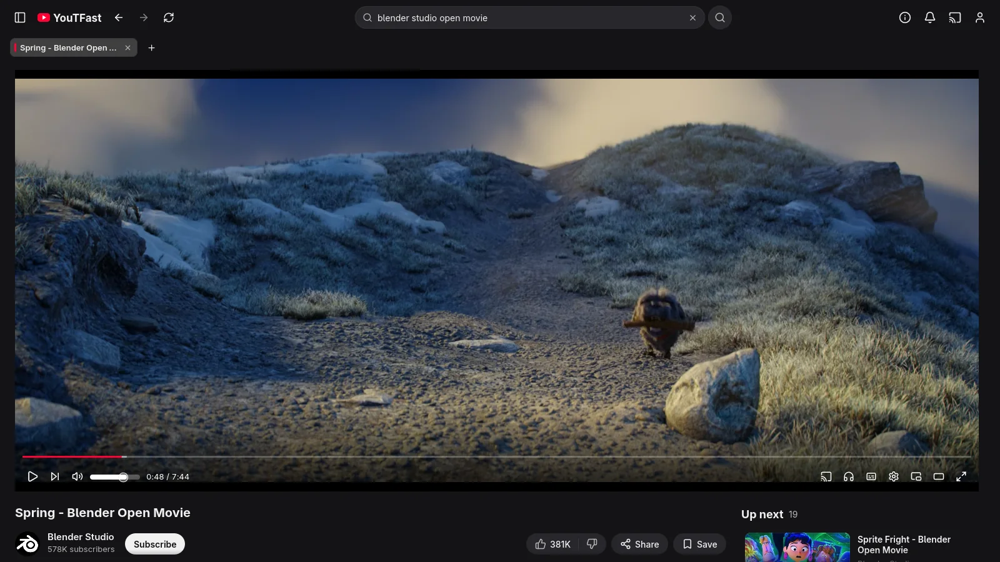
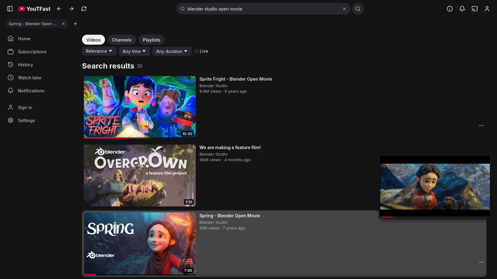
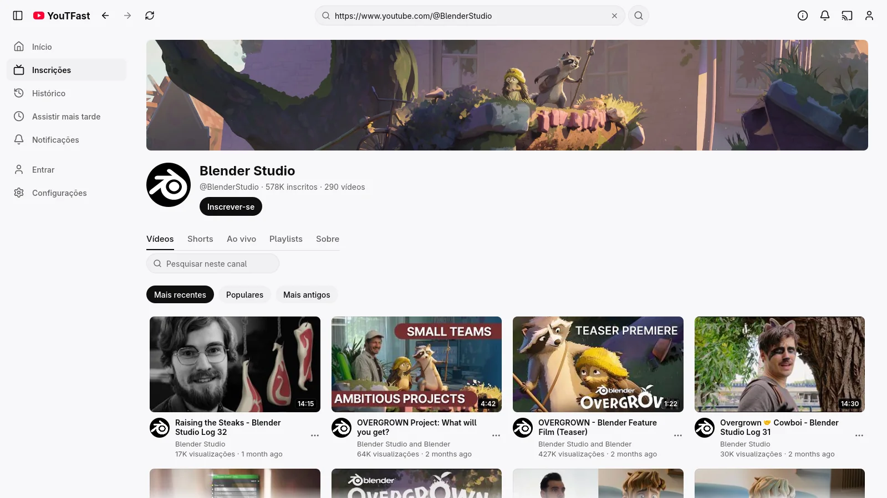

<p align="center">
  
</p>
<h1 align="center">YouTFast</h1>
<p align="center"><strong>YouTube, nativo e veloce.</strong></p>
<p align="center">
  <a href="https://github.com/bcosta19/youtfast/actions/workflows/ci.yml"></a>
  <a href="https://github.com/bcosta19/youtfast/releases/latest"></a>
  <a href="https://github.com/bcosta19/youtfast/releases"></a>
  <a href="../../../LICENSE"></a>
  
  
</p>
<p align="center">
  <a href="https://github.com/bcosta19/youtfast/releases">Release</a> ·
  <a href="https://youtfast.pages.dev/">Sito web</a> ·
  <a href="user-guide.md">Guida utente</a> ·
  <a href="../../../CHANGELOG.md">Changelog</a> ·
  <a href="../../../CONTRIBUTING.md">Contribuisci</a>
</p>
<p align="center">
  <a href="../../../README.md">English</a> ·
  <a href="../pt-BR/README.md">Português (Brasil)</a> ·
  <a href="../es/README.md">Español</a> ·
  <a href="../fr/README.md">Français</a> ·
  <a href="../de/README.md">Deutsch</a> ·
  <strong>Italiano</strong>
</p>

*Questa è una traduzione del [documento originale in inglese](../../../README.md); in caso di differenze, prevale la versione inglese.*

Un piccolo client desktop nativo per YouTube realizzato con **Rust, egui e libmpv**.
Cerca, guarda e gestisci la tua raccolta in un'interfaccia desktop, con la
decodifica video hardware dove supportata. Nessun motore di browser, nessuna
telemetria e nessun backend gestito da YouTFast. Si parte senza accesso; gli
account sono facoltativi.



<table>
  <tr>
    <td width="33%"><br>Modalità cinema</td>
    <td width="33%"><br>Miniplayer durante la navigazione</td>
    <td width="33%"><br>Tema chiaro, interfaccia in portoghese</td>
  </tr>
</table>

*Schermate di YouTFast su Linux, senza accesso. I film sono
[Spring](https://studio.blender.org/films/spring/) e
[Sprite Fright](https://studio.blender.org/films/sprite-fright/) di Blender
Studio ([CC BY 4.0](https://creativecommons.org/licenses/by/4.0/)).*

> [!NOTE]
> **YouTFast è giovane e ha ancora bisogno di lavoro.** Ha un solo manutentore
> ed è in sviluppo attivo `0.x`: riproduce già video, effettua ricerche e gestisce
> una raccolta, ma aspettati qualche asperità e funzionalità mancanti. Se qualcosa
> si rompe o sembra meno rifinito di YouTube nel browser, è un ottimo punto in
> cui dare una mano. Vedi [come contribuire](#cerchiamo-aiuto).

## Cosa puoi fare

| Funzionalità | In YouTFast |
|---|---|
| Guardare | Video nella finestra, schermo intero, modalità cinema, modalità Solo audio e un miniplayer compatto |
| Scoprire | Filtri di ricerca, schede del canale, playlist, Shorts e feed paginati |
| Avere il controllo | Sottotitoli, capitoli, modifica della coda, buffer video configurabile, scorciatoie da tastiera e controlli multimediali del desktop |
| Gestire una raccolta | Iscrizioni sul dispositivo, Guarda più tardi, cronologia/ripresa, History sync (sincronizzazione della cronologia) e importazione da Google Takeout |
| Leggere ed esplorare | Descrizioni, commenti e allegati; trascrizioni e anteprime sulla barra di avanzamento facoltative |
| Renderlo tuo | Sei lingue dell'interfaccia (EN, PT-BR, ES, FR, DE, IT), temi chiaro/scuro, tavolozze e integrazione nativa con Omarchy su Linux |

Gli account facoltativi usano l'archivio delle credenziali di sistema. Le
valutazioni e le modifiche alle playlist dell'account agiscono sull'account
selezionato; le iscrizioni e il Guarda più tardi del dispositivo restano locali.
[Leggi di account e dati salvati](user-guide.md#la-tua-raccolta-con-o-senza-account).

## Più leggero di un sito web in una finestra

Molte "app desktop per YouTube" sono il sito web dentro Electron. Misurato su un
portatile Linux con gli stessi risultati di ricerca (`"blender open movie"`) e la
riproduzione a 1080p di *Spring*, a schermo intero, senza accesso
([metodo, tutte le esecuzioni e avvertenze](../../benchmarks.md)):

| | YouTFast 0.7.0 | Electron 44 + youtube.com |
|---|---:|---:|
| Ricerca: memoria (PSS, tutti i processi) | **136 MiB** | 662 MiB |
| Ricerca: CPU a riposo | **0,0%** | 5,6% di un core |
| Riproduzione (1080p): memoria | **206 MiB** | 625 MiB |
| Riproduzione (1080p): CPU | **13,9%** | 41,2% di un core |
| Processi | **1** | 8 |
| Prima finestra sullo schermo | **0,5 s** | 0,7 s |
| Su disco | **29 MB** (13 MB di download) | 316 MB (301 MiB) solo il runtime |

Sono benvenuti i numeri misurati su altre macchine.

## Installazione

**[Guida all'installazione passo per passo](install.md)**, per ogni sistema:
Flatpak, Arch, Ubuntu/Debian, Fedora, Windows e macOS, con aggiornamento e
rimozione. Anche sul sito web: <https://youtfast.pages.dev/install>.

Le versioni pubblicate sono elencate in GitHub Releases. Un aumento di versione
nel repository non significa che i relativi pacchetti siano stati pubblicati.
I pacchetti vengono compilati e testati senza interfaccia grafica su runner
ospitati da GitHub; le verifiche interattive su macchine Windows e macOS pulite
sono ancora in corso. Scarica da
[GitHub Releases](https://github.com/bcosta19/youtfast/releases).

| Piattaforma | Pacchetto | Requisiti |
|---|---|---|
| Linux x86_64 | Bundle Flatpak o `install.sh` | Flatpak, runtime Freedesktop 25.08 e driver/portali del desktop |
| Linux x86_64 | Archivio nativo | glibc 2.39+, libmpv di sistema 0.42+ con Lua e yt-dlp/Deno aggiornati; supporta gli aggiornamenti dall'app |
| Windows x86_64 | Installer `.exe` (NSIS), `install.ps1` o ZIP portatile | yt-dlp/Deno aggiornati nel PATH (l'installer `.exe` installa quelli mancanti tramite winget); supporta gli aggiornamenti dall'app; nessuna firma dell'editore |
| macOS 15+ Apple Silicon | ZIP con app e dylib | yt-dlp/Deno aggiornati; supporta gli aggiornamenti dall'app; firma ad hoc, non notarizzata |
| Arch Linux x86_64 | Pacchetto pacman (`pacman -U` o `install.sh`) e PKGBUILD sorgente | Compilato e installato dalla CI in un container Arch pulito; registrazione su AUR attualmente chiusa |

Gli archivi/bundle nativi includono un sistema di aggiornamento integrato in
**Impostazioni → Informazioni** (verifica SHA-256 rispetto a `checksums.txt`, con
aggiornamenti minor/patch automatici facoltativi e aggiornamenti major manuali
con un clic). Le build di release generano anche i manifest già pronti per
Flathub, Winget e Homebrew Cask (`channels.tar.gz`).
Il Flatpak include i propri strumenti di riproduzione/estrazione ed è destinato
alle distribuzioni Linux compatibili su x86_64. Non è ancora presente su Flathub
né offre un remote per gli aggiornamenti dell'app.
La ricetta Arch non è ancora una voce AUR né un pacchetto pacman ufficiale.

[Dettagli delle piattaforme, checksum e limiti](../../distribution.md) ·
[Manutenzione del pacchetto Arch](../../../packaging/arch/README.md)

## Compilare dal sorgente

Installa il compilatore e le dipendenze di sistema indicate in
[CONTRIBUTING.md](../../../CONTRIBUTING.md#getting-started), poi esegui dalla copia del repository:

```sh
cargo run --locked --release
cargo run --locked --release -- "https://youtu.be/dQw4w9WgXcQ"
cargo run --locked --release -- "rust egui"
```

La riproduzione richiede **libmpv 0.42 o successiva con supporto Lua**, yt-dlp
aggiornato e il relativo runtime EJS/JS. Le versioni di mpv più vecchie possono
aprire gli URL dei flussi prima che diventino disponibili, causando errori HTTP
403 intermittenti. L'importazione facoltativa della sessione del browser richiede
anche `python3` con il modulo `yt_dlp`. Vedi i
[requisiti](user-guide.md#requisiti).

**Trasmetti alla TV** supporta le TV con YouTube tramite DIAL/Lounge nativi,
comprese le TV Samsung compatibili senza Chromecast. Il supporto a Google Cast
usa inoltre un eseguibile [`catt`](https://github.com/skorokithakis/catt)
installato separatamente nel `PATH`. Il pulsante accanto a Solo audio nel player,
o nella barra superiore, apre la scelta della TV e il telecomando. Una TV può
anche essere trovata tramite il suo IP locale. Vedi
[Trasmetti alla TV](user-guide.md#trasmetti-alla-tv) per configurazione,
dispositivi supportati e limiti.

## Cerchiamo aiuto

YouTFast migliora con ogni segnalazione di bug, prova e pull request, e non serve
conoscere Rust per aiutare:

- **Provalo e raccontaci cosa si rompe.** Soprattutto su Windows e macOS, che
  finora sono stati testati solo dalla CI. I passaggi per riprodurre il problema
  sono l'aiuto più utile.
- **Scegli una issue.** Cerca le
  [good first issue](https://github.com/bcosta19/youtfast/labels/good%20first%20issue)
  e le [help wanted](https://github.com/bcosta19/youtfast/labels/help%20wanted).
- **Traduci.** Esistono inglese, portoghese brasiliano, spagnolo, francese, tedesco e italiano; altre lingue sono benvenute.
- **Crea i pacchetti.** Ogni aiuto con Winget, il tap Homebrew e i pacchetti delle distribuzioni è benvenuto.
- **Misuralo.** Esegui i [benchmark](../../benchmarks.md) sulla tua macchina.

Inizia da [CONTRIBUTING.md](../../../CONTRIBUTING.md); le domande nelle issue sono benvenute.

## Guide e stato del progetto

| Vuoi… | Leggi |
|---|---|
| Imparare controlli, raccolta, account e temi | [Guida utente](user-guide.md) |
| Installare, aggiornare o rimuovere YouTFast | [Guida all'installazione](install.md) |
| Scegliere un pacchetto o verificare la copertura delle piattaforme | [Distribuzione](../../distribution.md) |
| Vedere contenuti ed esclusioni delle release | [Changelog](../../../CHANGELOG.md) |
| Vedere il lavoro non ancora implementato | [Roadmap](../../../ROADMAP.md) |
| Segnalare un bug o contribuire | [Contribuire](../../../CONTRIBUTING.md) |
| Segnalare in privato un problema di sicurezza | [Politica di sicurezza](../../../SECURITY.md) |
| Confrontare l'uso delle risorse | [Benchmark](../../benchmarks.md) |
| Preparare una release | [Processo di release](../../../RELEASING.md) |

Raccolta e impostazioni restano su questo dispositivo. I cookie dell'account
vanno nell'archivio nativo delle credenziali e la diagnostica locale oscura i
dati privati. L'accesso con l'account non è ufficiale e può provocare una
verifica da parte di Google, la disconnessione o la sospensione.
Usa l'app senza accesso, a meno che tu non scelga deliberatamente questa integrazione.
[Archiviazione, privacy e dettagli sugli account](user-guide.md#la-tua-raccolta-con-o-senza-account).

## Progetti correlati e ringraziamenti

- [Spotifast](https://github.com/crmne/spotifast) — client nativo per Spotify.
- [ZapFast](https://github.com/crmne/zapfast) — client nativo per WhatsApp.
- [fastframe](https://github.com/crmne/fastframe) — basi condivise per
  applicazioni desktop native in egui.

YouTFast segue le convenzioni desktop native di questi progetti e usa fork
condivisi di egui/winit. Grazie anche a [mpv](https://mpv.io),
[yt-dlp](https://github.com/yt-dlp/yt-dlp),
[egui](https://github.com/emilk/egui) e [Lucide](https://lucide.dev).
Il client InnerTube di YouTFast è sviluppato in questo repository; le release
precedenti usavano [RustyPipe](https://codeberg.org/ThetaDev/rustypipe).

## Licenza e avvertenze

[GPL-3.0-only](../../../LICENSE). Le dipendenze mantengono le proprie licenze e note;
vedi [THIRD_PARTY_NOTICES.md](../../../THIRD_PARTY_NOTICES.md).

YouTFast è un client non ufficiale, non affiliato a YouTube né a Google. L'uso di
un client non ufficiale può essere in contrasto con i termini di servizio di
YouTube. Usalo a tuo rischio.
