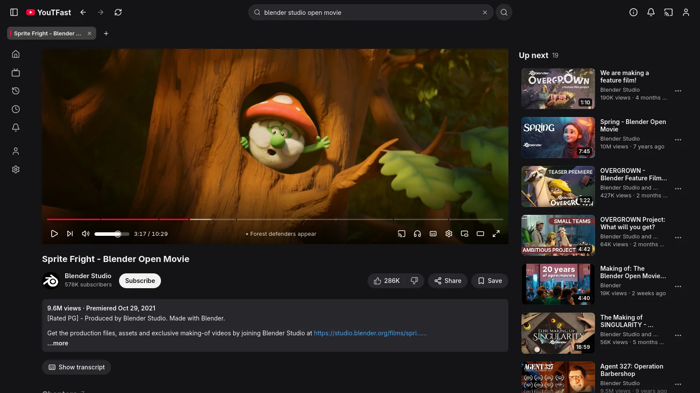
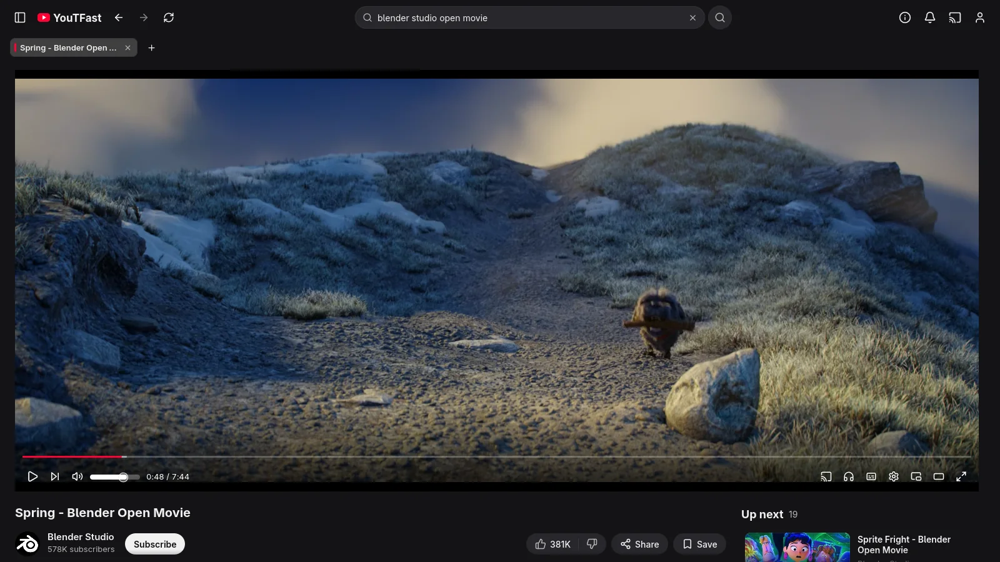
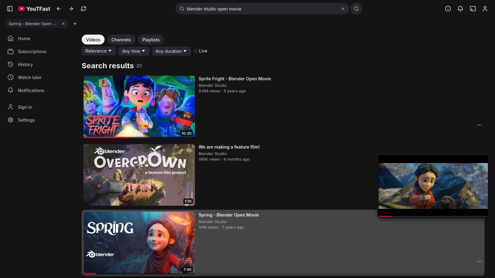
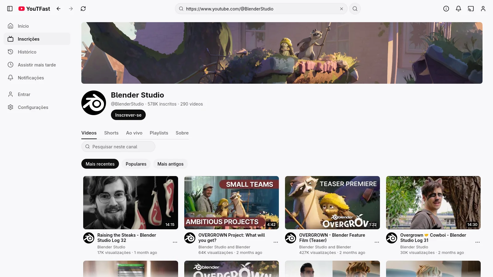

<p align="center">
  
</p>
<h1 align="center">YouTFast</h1>
<p align="center"><strong>YouTube, nativo e rápido.</strong></p>
<p align="center">
  <a href="https://github.com/bcosta19/youtfast/actions/workflows/ci.yml"></a>
  <a href="https://github.com/bcosta19/youtfast/releases/latest"></a>
  <a href="https://github.com/bcosta19/youtfast/releases"></a>
  <a href="../../../LICENSE"></a>
  
  
</p>
<p align="center">
  <a href="https://github.com/bcosta19/youtfast/releases">Versões</a> ·
  <a href="https://youtfast.pages.dev/">Site</a> ·
  <a href="user-guide.md">Guia do usuário</a> ·
  <a href="../../../CHANGELOG.md">Changelog</a> ·
  <a href="../../../CONTRIBUTING.md">Contribua</a>
</p>
<p align="center">
  <a href="../../../README.md">English</a> ·
  <strong>Português (Brasil)</strong> ·
  <a href="../es/README.md">Español</a> ·
  <a href="../fr/README.md">Français</a> ·
  <a href="../de/README.md">Deutsch</a> ·
  <a href="../it/README.md">Italiano</a>
</p>

*Esta é uma tradução do [documento original em inglês](../../../README.md); se houver diferenças entre os dois, vale a versão em inglês.*

Assista, pesquise e mantenha sua biblioteca do YouTube em um app desktop nativo,
em vez de uma aba do navegador. Ele usa uma fração da memória e da CPU do site
dentro de uma janela Electron ([medido abaixo](#mais-leve-que-um-site-dentro-de-uma-janela)),
com decodificação de vídeo por hardware onde houver suporte. Sem motor de
navegador, sem telemetria e sem servidor operado pelo YouTFast. Comece sem
entrar em uma conta; contas são opcionais. Feito com **Rust, egui e libmpv**.



<table>
  <tr>
    <td width="33%"><br>Modo cinema</td>
    <td width="33%"><br>Miniplayer enquanto navega</td>
    <td width="33%"><br>Tema claro, interface em português</td>
  </tr>
</table>

*Capturas de tela do YouTFast no Linux, sem conta conectada. Os filmes são
[Spring](https://studio.blender.org/films/spring/) e
[Sprite Fright](https://studio.blender.org/films/sprite-fright/), do Blender
Studio ([CC BY 4.0](https://creativecommons.org/licenses/by/4.0/)).*

## Instalação rápida

Linux (x86_64): o pacote Flatpak, ou o pacote do pacman em sistemas baseados no Arch:

```sh
curl -fsSL https://youtfast.pages.dev/install.sh | sh
```

Windows 10/11, no PowerShell:

```powershell
irm https://youtfast.pages.dev/install.ps1 | iex
```

macOS 15+ com Apple Silicon, pelo Homebrew:

```sh
brew install --cask bcosta19/tap/youtfast
```

Cada um confere o SHA-256 do download. O instalador `.exe`, os arquivos ZIP e
todos os outros caminhos estão em [Instalação](#instalação).

> [!NOTE]
> **O YouTFast é novo e ainda precisa de trabalho.** Ele tem um único mantenedor
> e está em desenvolvimento ativo na série `0.x`: já reproduz, pesquisa e mantém
> uma biblioteca, mas espere arestas a aparar e partes faltando. Se algo
> quebrar ou parecer menos polido do que o YouTube no navegador, esse é um ótimo
> lugar para ajudar. Veja [como contribuir](#precisamos-de-ajuda).

## O que você pode fazer

| Recurso | No YouTFast |
|---|---|
| Assistir | Vídeo dentro da janela, tela cheia, modo cinema, modo apenas áudio e um miniplayer compacto |
| Descobrir | Filtros de pesquisa, abas de canal, playlists, Shorts e feeds paginados |
| Manter o controle | Legendas, capítulos, edição da fila, buffer de vídeo configurável, atalhos do teclado e controles de mídia do desktop |
| Manter uma biblioteca | Inscrições no dispositivo, Assistir mais tarde, histórico/retomada, Sincronização do histórico e importação do Google Takeout |
| Ler e explorar | Descrições, comentários e anexos; transcrições e prévias na linha do tempo opcionais |
| Deixar do seu jeito | Seis idiomas de interface (EN, PT-BR, ES, FR, DE, IT), temas claro/escuro, paletas e integração nativa com o Omarchy no Linux |

As contas opcionais usam o armazenamento de credenciais do sistema. Avaliações e
edições de playlists da conta afetam a conta selecionada; as inscrições e o
Assistir mais tarde do dispositivo ficam locais. [Leia sobre contas e dados armazenados](user-guide.md#sua-biblioteca-com-ou-sem-conta).

## Mais leve que um site dentro de uma janela

Muitos "apps desktop do YouTube" são o site dentro do Electron. Medido em um
notebook Linux, com os mesmos resultados de pesquisa (`"blender open movie"`) e
reprodução em 1080p de *Spring*, em tela cheia, sem conta conectada
([método, todas as execuções e ressalvas](../../benchmarks.md)):

| | YouTFast 0.7.0 | Electron 44 + youtube.com |
|---|---:|---:|
| Pesquisa: memória (PSS, todos os processos) | **136 MiB** | 662 MiB |
| Pesquisa: CPU em repouso | **0,0%** | 5,6% de um núcleo |
| Reprodução (1080p): memória | **206 MiB** | 625 MiB |
| Reprodução (1080p): CPU | **13,9%** | 41,2% de um núcleo |
| Processos | **1** | 8 |
| Primeira janela na tela | **0,5 s** | 0,7 s |
| Em disco | **29 MB** (download de 13 MB) | 316 MB (301 MiB) só o runtime |

Números de outras máquinas são bem-vindos.

## Instalação

**[Guia de instalação passo a passo](install.md)**, para cada sistema:
Flatpak, Arch, Ubuntu/Debian, Fedora, Windows e macOS, com atualização e
remoção. Também no site: <https://youtfast.pages.dev/install>.

As versões publicadas estão listadas no GitHub Releases. Uma mudança de versão
no repositório não significa que os pacotes dela já foram publicados.
Os pacotes são compilados e testados sem interface gráfica em runners hospedados
pelo GitHub; as verificações interativas em máquinas Windows e macOS limpas ainda
estão em andamento. Baixe em
[GitHub Releases](https://github.com/bcosta19/youtfast/releases).

| Plataforma | Pacote | Requisitos |
|---|---|---|
| Linux x86_64 | Bundle Flatpak ou `install.sh` | Flatpak, runtime Freedesktop 25.08 e drivers/portais do desktop |
| Linux x86_64 | Arquivo compactado nativo | glibc 2.39+, libmpv 0.42+ do sistema com Lua e yt-dlp/Deno atuais; suporta atualizações pelo app |
| Windows x86_64 | Instalador `.exe` (NSIS), `install.ps1` ou ZIP portátil | yt-dlp/Deno atuais no PATH (o instalador `.exe` instala os que faltarem via winget); suporta atualizações pelo app; sem assinatura de publicador |
| macOS 15+ Apple Silicon | ZIP com o app e as dylibs | yt-dlp/Deno atuais; suporta atualizações pelo app; assinatura ad-hoc, sem notarização |
| Arch Linux x86_64 | Pacote pacman (`pacman -U` ou `install.sh`) e PKGBUILD de código-fonte | Compilado e instalado pela CI em um contêiner Arch limpo; o registro no AUR está fechado no momento |

Os arquivos compactados/bundles nativos incluem um atualizador no app em
**Configurações → Sobre** (verificação SHA-256 contra `checksums.txt`, com
atualizações minor/patch automáticas opcionais e atualizações major manuais com
1 clique). As builds de release também geram manifestos prontos para Flathub,
Winget e Homebrew Cask (`channels.tar.gz`).
O Flatpak inclui suas ferramentas de reprodução/extração e é voltado a
distribuições Linux compatíveis em x86_64. Ele ainda não está listado no Flathub
nem é um remote de atualização do app.
A receita do Arch ainda não é uma entrada do AUR nem um pacote oficial do pacman.

[Detalhes das plataformas, checksums e limites](../../distribution.md) ·
[Manutenção do pacote Arch](../../../packaging/arch/README.md)

## Compilar a partir do código-fonte

Instale o compilador e as dependências do sistema descritas em
[CONTRIBUTING.md](../../../CONTRIBUTING.md#getting-started) e, então, execute a
partir do checkout:

```sh
cargo run --locked --release
cargo run --locked --release -- "https://youtu.be/dQw4w9WgXcQ"
cargo run --locked --release -- "rust egui"
```

A reprodução precisa da **libmpv 0.42 ou mais recente com suporte a Lua**, de um
yt-dlp atual e do runtime EJS/JS correspondente. Versões mais antigas do mpv
podem abrir URLs de stream antes que fiquem disponíveis, causando falhas HTTP 403
intermitentes. A importação opcional da sessão do navegador também precisa de
`python3` com o módulo `yt_dlp`. Veja os
[requisitos](user-guide.md#requisitos).

**Transmitir para TV** suporta TVs com YouTube por DIAL/Lounge nativos,
incluindo TVs Samsung compatíveis sem Chromecast. O suporte a Google Cast usa,
além disso, um executável [`catt`](https://github.com/skorokithakis/catt)
instalado à parte no `PATH`. O botão ao lado de Apenas áudio no player, ou na
barra superior, abre o seletor de TVs e o controle remoto. Uma TV também pode ser
encontrada pelo seu IP local. Veja
[Transmitir para TV](user-guide.md#transmitir-para-tv) para configuração, alvos
suportados e limites.

## Precisamos de ajuda

O YouTFast melhora a cada relato de bug, rodada de testes e pull request, e você
não precisa saber Rust para ajudar:

- **Experimente e conte o que quebra.** Principalmente no Windows e no macOS,
  que até agora só foram testados pela CI. Passos para reproduzir são o que
  mais ajuda.
- **Escolha uma issue.** Procure por
  [good first issues](https://github.com/bcosta19/youtfast/labels/good%20first%20issue)
  e [help wanted](https://github.com/bcosta19/youtfast/labels/help%20wanted).
- **Traduza.** Já existem inglês, português do Brasil, espanhol, francês, alemão e italiano; mais idiomas são bem-vindos.
- **Empacote.** Ajuda com Winget, tap do Homebrew e pacotes de distribuições é bem-vinda.
- **Meça.** Rode os [benchmarks](../../benchmarks.md) na sua máquina.

Comece pelo [CONTRIBUTING.md](../../../CONTRIBUTING.md); perguntas nas issues
são bem-vindas.

## Guias e situação do projeto

| Você quer… | Leia |
|---|---|
| Aprender os controles, a biblioteca, as contas e os temas | [Guia do usuário](user-guide.md) |
| Instalar, atualizar ou remover o YouTFast | [Guia de instalação](install.md) |
| Escolher um pacote ou conferir a cobertura de plataformas | [Distribuição](../../distribution.md) |
| Ver o conteúdo e as exclusões de cada versão | [Changelog](../../../CHANGELOG.md) |
| Ver o que ainda não foi implementado | [Roadmap](../../../ROADMAP.md) |
| Relatar um bug ou contribuir | [Como contribuir](../../../CONTRIBUTING.md) |
| Relatar um problema de segurança em particular | [Política de segurança](../../../SECURITY.md) |
| Comparar o uso de recursos | [Benchmarks](../../benchmarks.md) |
| Preparar uma versão | [Processo de release](../../../RELEASING.md) |

A biblioteca e as configurações ficam neste dispositivo. Os cookies da conta
ficam no armazenamento nativo de credenciais, e os diagnósticos locais ocultam
detalhes privados. O acesso à conta não é oficial e pode provocar verificação
pelo Google, encerramento da sessão ou suspensão. Use o app sem entrar em uma
conta, a menos que você escolha essa integração deliberadamente.
[Armazenamento, privacidade e detalhes sobre contas](user-guide.md#sua-biblioteca-com-ou-sem-conta).

## Projetos relacionados e agradecimentos

- [Spotifast](https://github.com/crmne/spotifast) — cliente nativo do Spotify.
- [ZapFast](https://github.com/crmne/zapfast) — cliente nativo do WhatsApp.
- [fastframe](https://github.com/crmne/fastframe) — base compartilhada para
  aplicativos desktop nativos em egui.

O YouTFast segue as convenções de desktop nativo desses projetos e usa forks
compartilhados de egui/winit. Agradecemos também ao [mpv](https://mpv.io),
[yt-dlp](https://github.com/yt-dlp/yt-dlp),
[egui](https://github.com/emilk/egui) e [Lucide](https://lucide.dev).
O cliente InnerTube do YouTFast é desenvolvido neste repositório; versões
anteriores usavam o [RustyPipe](https://codeberg.org/ThetaDev/rustypipe).

## Licença e aviso legal

[GPL-3.0-only](../../../LICENSE). As dependências mantêm suas próprias licenças e
avisos; veja [THIRD_PARTY_NOTICES.md](../../../THIRD_PARTY_NOTICES.md).

O YouTFast é um cliente não oficial, sem vínculo com o YouTube ou o Google. Usar
um cliente não oficial pode entrar em conflito com os termos de serviço do
YouTube. Use por sua conta e risco.
